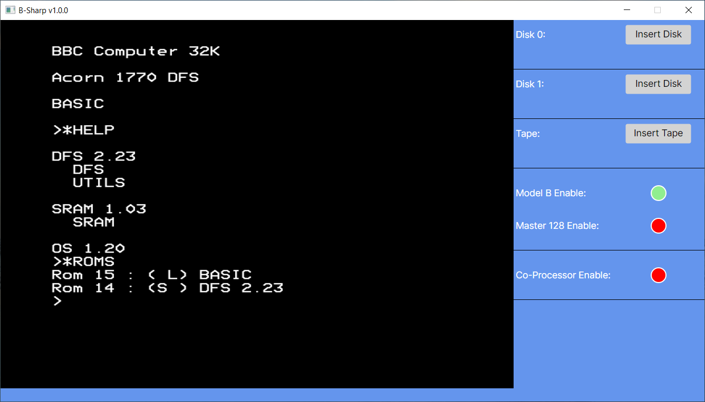
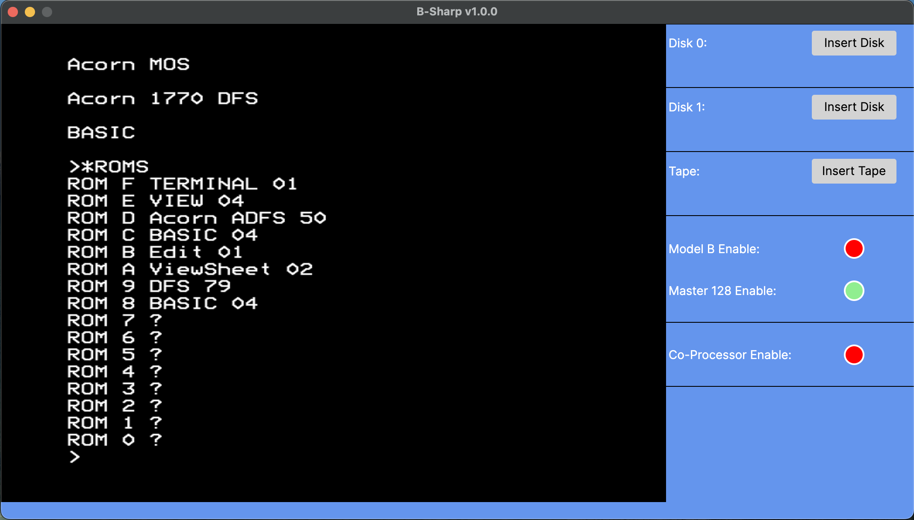

# BSharp
BBC Micro emulator written in C# using:  
Avalonia UI for the user interface  
Silk.Net (OpenAL for sound and GLFW for handling a USB joystick)

Codebase will compile for:

Windows  

and Mac  

## Thanks to:
Everyone that contributed to the many Stardot forum threads.

A big shout out to Matt Godbolt and jsbeeb.  
This is not because I pinched any of his code but because it is such an accessible emulator.  
I can't count the number of times I've single stepped through some test program or another in the jsbeeb debugger looking for where BSharp deviated.

## Release History
Releases can be found in the IJCalypso/BSharpReleases repository.  
They are standalone so can be run from the directory that the zip file is extracted to without needing any additional installation.

MacOS will probably block execution as the files are from an unknown source. If you wish to circumvent this it will be necessary to open a Terminal window and issue the command: xattr -cr path_to_folder. 

**v1.0.0 29/05/2026**  
BBC Model B emulation with a 2MHz 6502A cpu and 3MHz 65C02 co-processor.  
BBC Master 128 emulation with a 2MHz 65C02 cpu and 4MHz 65C02 co-processor.  
1770 disk emulation - 8271 not emulated.  
DFS and ADFS supported for read and write.  
Tape reading supported (good enough to load Nightshade anyway).  
Serial writing supported (*FX3,5 will send output to the BSharpAcia.bin file).  
USB analogue joystick supported (If set up in DS4 mode).  
